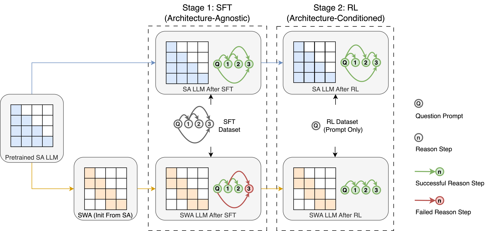

<div align="center">

# 🧠 Architecture-Conditioned Reinforcement Learning Makes Sliding-Window Attention Competitive in Math Reasoning

<p>
  <a href="https://arxiv.org/abs/2606.11634">
    
  </a>
  <a href="https://arxiv.org/abs/2606.11634">
    
  </a>
  <a href="https://huggingface.co/collections/KaiLiu1998/swa-sft-models">
    
  </a>
  <a href="LICENSE">
    
  </a>
  <a href="https://github.com/LKJacky/alloylm">
    
  </a>
</p>

**Training and evaluation configuration for the paper**  
*Architecture-Conditioned Reinforcement Learning Makes Sliding-Window Attention Competitive in Math Reasoning*

</div>

---

## 🔗 Quick Links

| | Resource | Link |
|---|---|---|
| 📄 | Paper | [arXiv:2606.11634](https://arxiv.org/abs/2606.11634) |
| 🎓 | Venue | **EMNLP 2026** |
| 🤗 | Model Collection | [KaiLiu1998/swa-sft-models](https://huggingface.co/collections/KaiLiu1998/swa-sft-models) |
| ⚡ | Training Framework | [AlloyLM](https://github.com/LKJacky/alloylm) |
| ⚖️ | License | [Apache-2.0](LICENSE) |

---

## Pipeline



The experiment is built on [AlloyLM](https://github.com/LKJacky/alloylm) and studies RL post-training for math reasoning with a sliding-window-attention model.

## Repository layout

```text
swarr/configs/rl.py        RL experiment configuration
swarr/configs/eval.py      Standalone evaluation configuration
scripts/train.sh           Training entry point
scripts/eval.sh            Evaluation entry point
scripts/infer.sh           AlloyLM inference server entry point
scripts/infer.py           AlloyLM inference server implementation
data/eval/                 Evaluation sets in JSONL format
data/smoke/                Synthetic smoke-test data
swarr/configs/smoke.py     1-GPU smoke training config
.devcontainer/             Development container
.pre-commit-config.yaml    Formatting and lint hooks
requirements.txt           Python dependencies
```

## Requirements

- Linux with CUDA-capable GPUs
- Python 3.11+
- PyTorch with CUDA support
- One or more CUDA GPUs; use `SP` to trade communication for per-GPU memory

This repository includes a devcontainer based on:

```text
pytorch/pytorch:2.12.0-cuda13.0-cudnn9-devel
```

The devcontainer expects a local `~/.env` file. If you do not need private environment variables, create an empty file before opening the container:

```bash
touch ~/.env
```

## Installation

```bash
git clone https://github.com/LKJacky/architecture-conditioned-rl.git
cd architecture-conditioned-rl
python -m venv .venv
source .venv/bin/activate
python -m pip install --upgrade pip
pip install -r requirements.txt
```

## Model

The default model is:

```text
KaiLiu1998/SWARR-SWA8K-1.5B-SFT
```

It can be overridden with `LLM` and `TOKENIZER`:

```bash
LLM=/path/to/model TOKENIZER=/path/to/tokenizer python -m alloylm.algorithm.rl.run swarr/configs/rl.py
```

## Training

Run the RL entry point with the experiment configuration:

```bash
bash scripts/train.sh
```

The script detects the local GPU count, checks the FSDP divisibility constraint, and then runs:

```bash
python -m alloylm.algorithm.rl.run swarr/configs/rl.py
```

Example for 8 GPUs on one node:

```bash
GPU=8 \
WORLD_SIZE=1 \
WORK_DIR=work_dirs/default \
python -m alloylm.algorithm.rl.run swarr/configs/rl.py
```

For multi-node runs, set `GPU` to the number of GPUs per node and `WORLD_SIZE` to the number of nodes.

> The FSDP train mesh is `(NUM_WORKERS // SP, SP)`. `SP` defaults to 1; increase it to 2/4/8 when GPU memory is tight. `GPU * WORLD_SIZE` must be divisible by `SP`.

## Inference server

`scripts/infer.sh` serves a checkpoint with AlloyLM's own OpenAI-compatible inference engine:

```bash
MODEL=work_dirs/default/best_ckpt/hf \
PORT=8000 \
MODEL_NAME=ALLOYLM \
bash scripts/infer.sh
```

It exposes:

```text
GET  /health
GET  /v1/models
POST /v1/chat/completions
```

The default model path is `work_dirs/default/best_ckpt/hf`. This script currently serves a single GPU; `scripts/train.sh` handles multi-GPU training.

Then run evaluation against that server:

```bash
EVAL_URL=http://127.0.0.1:8000/v1 \
EVAL_MODEL_NAME=ALLOYLM \
bash scripts/eval.sh
```

## Evaluation

Evaluation datasets are declared in `swarr/configs/rl.py` and run during training at `eval_interval`. For standalone evaluation against an OpenAI-compatible endpoint:

```bash
EVAL_URL=http://127.0.0.1:8000/v1 \
EVAL_MODEL_NAME=ALLOYLM \
bash scripts/eval.sh
```

Set `EVAL_URL` to the OpenAI-compatible model server and `EVAL_MODEL_NAME` to the served model name. Results are written under `EVAL_WORK_DIR` (default: `work_dirs/eval`). `EVAL_CONFIG` selects the evaluation config (default: `swarr/configs/eval.py`).

The included evaluation sets are:

| File | Examples |
|---|---:|
| `data/eval/aime24.jsonl` | 30 |
| `data/eval/aime25.jsonl` | 30 |
| `data/eval/amc.jsonl` | 83 |
| `data/eval/math_500.jsonl` | 500 |
| `data/eval/olympiad.jsonl` | 674 |

Each line is a JSON object with:

```json
{
  "messages": [{"role": "user", "content": "..."}],
  "answer": "..."
}
```

`answer` is checked with `math_verify` after extracting the final `\boxed{...}` answer.

### Data provenance

The evaluation files are derived from public math-reasoning benchmarks. Before redistributing or reusing them, verify the license and attribution requirements of the original benchmark sources. The training set is loaded from Hugging Face:

```text
nvidia/AceReason-Math
```

and is not redistributed in this repository.

## Smoke test

`swarr/configs/smoke.py` is a single-GPU smoke test: `Qwen/Qwen2.5-0.5B-Instruct`, four synthetic training examples, and two evaluation examples. It runs one rollout/evaluation/optimization step.

```bash
HF_HUB_OFFLINE=1 CUDA_VISIBLE_DEVICES=0 \
python -m alloylm.algorithm.rl.run swarr/configs/smoke.py
```

The smoke configuration evaluates at step 0 and writes to `work_dirs/smoke`. It is intended to verify that model loading, rollout, evaluation, optimization, and checkpoint writing work end to end, not to produce meaningful accuracy.

## Configuration

The main configuration is `swarr/configs/rl.py`. Commonly changed values can be set through environment variables:

| Variable | Default | Meaning |
|---|---|---|
| `LLM` | `KaiLiu1998/SWARR-SWA8K-1.5B-SFT` | Model path or Hugging Face id |
| `TOKENIZER` | same as `LLM` | Tokenizer path or id |
| `WORK_DIR` | `work_dirs/default` | Checkpoint and log directory |
| `GPU` | `1` | GPUs per node |
| `WORLD_SIZE` | `1` | Number of nodes |
| `SP` | `1` | Sequence-parallel degree; increase when GPU memory is tight |
| `ROLLOUT_BATCH_SIZE` | `128` | Rollout batch size |
| `CHECKPOINT_INTERVAL` | `100` | Checkpoint / evaluation interval |
| `ENTROPY_LOSS_SCALE` | `0.1` | Entropy-loss scale |
| `ENTROPY_TARGET` | `0.35` | Entropy target |
| `NEGATIVE_SCALE_FACTOR` | `1.0` | Negative-advantage scaling |
| `MAX_ENTROPY` | `4` | Maximum sampling entropy |
| `NUM_OPTIMIZE_PER_STEP` | `4` | Optimizer steps per rollout |
| `LR` | `1e-6` | Learning rate |
| `ADV_NORMALIZATION` | `1` | Enable negative-advantage normalization |

`TOTAL_TRAINING_STEPS` is currently set to `3000` in `swarr/configs/rl.py`.

The default `WORK_DIR` is `work_dirs/default`; override it for separate experiments.

## Reproducibility notes

- `alloylm` is pinned to commit `916950831f738af64d8e6f62a8aec28f5560dd17` in `requirements.txt`.
- Record the model revision, tokenizer revision, GPU count, batch size, and random seed.
- Evaluation prompt templates differ between some datasets; report the exact prompt template used in any comparison.
- Standalone evaluation requires an OpenAI-compatible model server; `scripts/eval.sh` does not start one.

## Citation

If you use this code, please cite the paper:

```bibtex
@article{liu2026architectureaware,
  title   = {Architecture-Aware Reinforcement Learning Makes Sliding-Window Attention Competitive in Math Reasoning},
  author  = {Liu, Kai and Dong, Peijie and Xie, Xinchen and Gao, Jianfei and Guo, Qipeng and Chu, Xiaowen and Zhang, Shaoting and Chen, Kai},
  journal = {arXiv preprint arXiv:2606.11634},
  year    = {2026},
  note    = {EMNLP 2026},
  url     = {https://arxiv.org/abs/2606.11634}
}
```

## License

This repository is released under the Apache License 2.0. See [LICENSE](LICENSE).

Third-party dependencies and datasets remain under their respective licenses.
